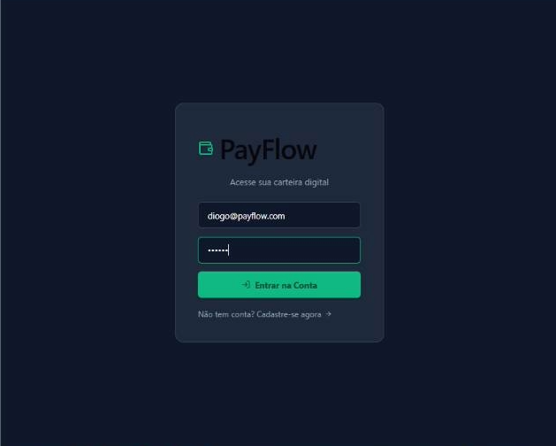
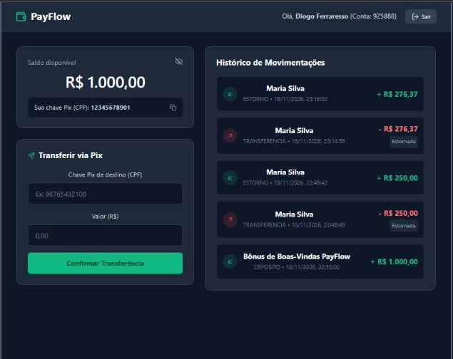

# 💸 PayFlow - Carteira Digital & Motor de Transferências Pix

O **PayFlow** é uma aplicação Full Stack desenvolvida para simular o núcleo financeiro de uma carteira digital moderna. A plataforma permite abertura de conta com bônus inicial auditável, transferências instantâneas via chave Pix, consulta de extrato em tempo real e estorno de transações recebidas.

## 📸 Demonstração

### Tela de Login e Cadastro



### Dashboard Financeiro e Extrato (Ledger)



---

## 🚀 Arquitetura e Tecnologias

### Backend (API RESTful)

- **Java 17 & Spring Boot 4:** Núcleo da aplicação e regras de negócio.
- **Spring Security & JWT (JJWT):** Autenticação stateless baseada em tokens assinados e criptografia de senhas com `BCryptPasswordEncoder`.
- **Spring Data JPA & PostgreSQL:** Persistência relacional com controle de bloqueio pessimista (`@Lock`).
- **JUnit 5 & Mockito:** Testes unitários automatizados cobrindo fluxo feliz, saldo insuficiente e idempotência.

### Frontend (Single Page Application)

- **React (Vite):** Interface responsiva em tema escuro.
- **Axios Interceptors:** Injeção automática do token JWT nas requisições e geração de chaves UUID de idempotência.
- **Lucide React:** Iconografia moderna.

---

## 🔒 Engenharia e Segurança Financeira Implementada

1. **Arquitetura de Ledger (Livro-Razão Imutável):**
   - Nenhuma transação é excluída ou editada no banco. Toda movimentação (depósito inicial, transferência ou estorno) gera um registro cronológico auditável.
2. **Idempotência (`Idempotency-Key`):**
   - O frontend gera um UUID único para cada tentativa de transferência. Caso ocorra clique duplo ou oscilação de rede, a API reconhece a chave já processada e devolve o recibo original sem debitar o saldo duas vezes.
3. **Controle de Concorrência e Prevenção de Deadlock:**
   - Uso de `LockModeType.PESSIMISTIC_WRITE` (`SELECT ... FOR UPDATE`) ordenando os IDs das contas envolvidas para evitar condições de corrida (_Race Conditions_) e _Deadlocks_ em transferências simultâneas.
4. **Precisão Monetária (`BigDecimal`):**
   - Todos os cálculos financeiros utilizam `BigDecimal` com escala fixa, eliminando erros de arredondamento de ponto flutuante.

---

## 🛠️ Como Executar Localmente

### 1. Banco de Dados (PostgreSQL)

Crie um banco chamado `payflow` no PostgreSQL e configure suas credenciais em `backend/src/main/resources/application.properties`.

### 2. Backend

```bash
cd backend
./mvnw spring-boot:run
```

### 3. Frontend

```bash
cd frontend
npm install
npm run dev
```

Acesse `http://localhost:5173` no navegador.

---

## 👨‍💻 Autor

Desenvolvido por **Diogo Dias Ferraresso**

- [GitHub](https://github.com/DiogoFerraresso19)
- [LinkedIn](https://www.linkedin.com/in/diferraresso19/)
